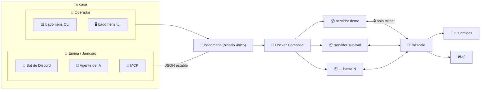

<div align="center">

# 🧱 badomens

**Tu servidor Minecraft en casa, sin dramas.** 🎮

Un solo binario para crear, vigilar y operar **varios servidores de Minecraft**
(Paper, Fabric, Forge, NeoForge o Vanilla) en tu propia red privada (Tailscale),
cada uno con su propio mundo, versión y recursos.

</div>

<div align="center">

| | | | |
|---|---|---|---|
| [](https://github.com/MrZudro/badomens/releases) | [](https://go.dev/) | [](LICENSE) | [](https://github.com/MrZudro/badomens/actions) |
| [](https://github.com/MrZudro/badomens/releases) | [](https://github.com/MrZudro/badomens/commits/main) | [](https://github.com/MrZudro/badomens/issues) | [](https://github.com/MrZudro/badomens/stargazers) |

</div>

---

## ✨ ¿Qué es badomens?

Es un **gestor de servidores Minecraft** que reúne en un solo programa todo lo que
antes hacías a mano:

- 🧩 Elige **motor** (Paper, Fabric, Forge, NeoForge o Vanilla) y **versión**.
- 🗺️ Dale un **mundo**, una **semilla**, recursos, whitelist, ops y plugins.
- 🐳 Levanta cada servidor en **Docker Compose**, aislado del resto.
- 🔒 Publica los puertos **solo en tu red Tailscale** (nunca en todas las interfaces).
- 📊 Supervisa **TPS, CPU y RAM** y crea **backups** con checksum.
- 🖥️ O péntalo desde una **TUI** interactiva o desde el CLI.

> [!NOTE]
> 👉 Esta es la **reescritura en Go** del antiguo proyecto Bad Omens (Python).
> Un solo binario, sin interfaz web: **CLI primero**, TUI después, y listo para
> usarse desde **Emiria** (asistente Jamcord) por CLI, bot de Discord, agente de
> IA y MCP.

---

## 🚦 Estado del proyecto

> [!IMPORTANT]
> Todo el plan está implementado ✅. Las fases se construyeron y verificaron una a una:

| Fase | Qué incluye | Estado |
|---|---|---|
| **F0** 🏗️ Fundación | Contrato JSON, `version`, `doctor`, `capacity`, `update`, MCP, CI y releases | ✅ |
| **F1** 🧩 Multi-instancia | `instance`, `setup`, motores, mundos, backups, plugins, planificador | ✅ |
| **F2** 🩺 Doctor TPS | `doctor tps`, `metrics`, `update --check` | ✅ |
| **F3** 🤖 Emiria | `jamcord mc`, herramientas `badomens_*`, bot `/mc` | ✅ |
| **F4** 🖥️ TUI | panel multi-instancia `badomens tui` | ✅ |
| **F5** 📦 Distribución | instalador de un comando + releases precompiladas | ✅ |

---

## 🏗️ Cómo encaja todo



---

## ✅ Requisitos

| Herramienta | Para qué | Cómo instalarla |
|---|---|---|
| 🐳 **Docker + Compose** | correr cada servidor en su contenedor | [docker.com](https://www.docker.com/) |
| 🛜 **Tailscale** | red privada entre tú y tu gente | [tailscale.com](https://tailscale.com/) |

> [!TIP]
> No necesitas Go ni Python (ni nada más): **badomens es un solo archivo** listo
> para ejecutar.

---

## 🚀 Instalación

### 🧭 Opción A — Instalador de un comando

<details>
<summary><b>🐧 macOS / Linux</b></summary>

```bash
curl -fsSL https://github.com/MrZudro/badomens/releases/latest/download/install.sh | sh
```

</details>

<details>
<summary><b>🪟 Windows (PowerShell)</b></summary>

```powershell
irm https://github.com/MrZudro/badomens/releases/latest/download/install.ps1 | iex
```

</details>

Los instaladores descargan el binario correcto para tu sistema, **verifican el
checksum** contra `checksums.txt` y lo dejan listo en
`/usr/local/bin/badomens` (macOS/Linux) o `%LOCALAPPDATA%\Programs\badomens`
(Windows).

### 🧭 Opción B — Desde las releases

Descarga el binario de tu sistema desde la
**[última release](https://github.com/MrZudro/badomens/releases)**: tenemos
binarios para **Windows, macOS y Linux**, en **amd64** (Intel/AMD) y **arm64**
(Apple Silicon y ARM moderno).

> [!NOTE]
> Solo se publican binarios de arquitecturas vigentes. No hay versiones
> deprecadas de 32 bits (`386`, `arm`) ni ensamblados antiguos.

### 🧭 Opción C — Desde el código

Necesitas **Go 1.27+**:

```bash
go install github.com/MrZudro/badomens/cmd/badomens@latest
```

## 🏁 Inicio rápido

```bash
# 🔍 ¿está todo listo? Docker, Tailscale y configuración
badomens doctor

# 🖥️ ¿cuánta CPU/RAM tienes y cuántas instancias caben?
badomens capacity

# ⚙️ crea la configuración global (+ tu carpeta de datos)
badomens config --init

# 🧩 crea y arranca un servidor (interactivo si no le pasas flags)
badomens setup --name "Survival" --engine paper --memory 6G --no-start
badomens -i survival start

# 📊 un vistazo general en la TUI
badomens tui

# 🗃️ backups y mantenimiento
badomens -i survival backup create
badomens instance close survival
```

> [!TIP]
> Puedes tener **hasta 5 instancias** registradas y **3 corriendo a la vez**
> (ajustables en `config.yaml`). Cada una con su mundo, motor, versión y puerto.

---

## 🗂️ Comandos

| Comando | Qué hace |
|---|---|
| `badomens setup` | 🧩 asistente interactivo/desatendido de configuración |
| `badomens instance list / inspect / create` | 📋 registro de instancias |
| `badomens instance start / stop / close / restart / remove` | 🔄 ciclo de vida (el `start` respeta el límite de paralelas) |
| `badomens engine list / current / use` | 🧠 catálogo y selección de motor/versión |
| `badomens world list / save / use / export / import` | 🌍 biblioteca compartida de mundos |
| `badomens backup create / list / restore / prune` | 🗃️ copias de seguridad por instancia |
| `badomens access …` | 🚧 whitelist y operadores vía consola |
| `badomens plugin add / list / remove` | 🔌 plugins/mods según motor (con aviso de TPS) |
| `badomens logs` · `badomens console <cmd>` | 📜 logs y consola de una instancia |
| `badomens doctor tps` | 🩺 diagnóstico de TPS/MSPT |
| `badomens metrics` | 📈 CPU/RAM/mundo/backups de una instancia |
| `badomens tui` | 🖥️ panel interactivo multi-instancia |
| `badomens mcp serve` | 🔌 servidor MCP por stdio |
| `badomens doctor` · `capacity` · `update` · `resolve-ip` | 🧪 herramientas del entorno |
| `badomens version` · `config` · `commands` | ℹ️ utilidades |

> [!TIP]
> Todos los comandos aceptan `--json` para una **salida estable** (lo que consume
> Emiria).

---

## 📜 Contrato de salida

Cada comando imprime **un único documento JSON** en stdout:

```json
{
  "ok": true,
  "exit_code": 0,
  "action": "doctor",
  "message": "doctor terminó sin problemas",
  "data": { "checks": [ ... ] },
  "timestamp": "2026-01-01T00:00:00Z"
}
```

- ✅ Códigos de salida: **0** éxito · **1** aviso · **2** error.
- ❌ En un error: `ok: false` y `error: { code, message, hint }`.
- 🔑 Códigos de error estables: `error_usage`, `error_not_found`,
  `error_dependency_missing`, `error_capacity_exceeded`, `error_unavailable`,
  `error_general`.

> [!IMPORTANT]
> Este contrato es la base de la integración con **Emiria/Jamcord**. No lo rompas.
> Detalle completo en [`docs/contrato-json.md`](docs/contrato-json.md).

---

## 🤖 Integración con Emiria (Jamcord)

badomens es **autónomo**. Jamcord lo consume ejecutando el binario y leyendo su
JSON estable, igual que hace con SeedMap. Así Emiria puede:

- 💬 Pedirte el estado por lenguaje natural (Discord/agente).
- ⚡ Usar el comando `/mc`.
- 🔌 Conectarse por MCP.

Ver [`docs/integracion-jamcord.md`](docs/integracion-jamcord.md).

---

## 🛠️ Desarrollo

```bash
make build     # 🏗️ compila bin/badomens
make test      # 🧪 pruebas unitarias
make lint      # 🧹 golangci-lint
make run       # ▶️ ejecuta en desarrollo
make doctor    # 🩺 diagnóstico rápido
```

> [!NOTE]
> En Windows con **Smart App Control** activo, a veces los binarios recién
> compilados se bloquean; `make test` compila las pruebas con `-ldflags=-w` para
> evitarlo.

Consulta también [`AGENTS.md`](AGENTS.md) (guía para agentes de IA) y
[`docs/`](docs/).

---

## ❓ Preguntas frecuentes

<details>
<summary><b>¿Cuántos servidores puedo tener?</b></summary>

Hasta **5 instancias** registradas (ajustable en `config.yaml`) y **3 corriendo
a la vez** por defecto. Bad omens comprueba la capacidad de tu equipo antes de
recomendarte el máximo de jugadores.
</details>

<details>
<summary><b>¿Cómo invitan a mis amigos?</b></summary>

Genera tu red en Tailscale, comparte los dispositivos, y dales la IP del tailnet
y el puerto de la instancia. badomens publica los puertos **solo** en esa IP.
</details>

<details>
<summary><b>¿Puedo jugar con cuentas crackeadas?</b></summary>

Sí. Por defecto `setup` crea servidores en modo *crackeado*; pasa `--online`
para activar el modo premium (cuentas de Mojang/Microsoft).
</details>

<details>
<summary><b>¿Los backups se verifican?</b></summary>

Sí: cada backup es un `.zip` acompañado de su `sha256`. Puedes restaurar,
listar y podar backups por instancia con `backup ...`.
</details>

---

## ⚖️ Licencia

**MIT** — ver [`LICENSE`](LICENSE), [`CONTRIBUTING.md`](CONTRIBUTING.md) y
[`SECURITY.md`](SECURITY.md).

> Proyecto hecho con 💜, **no afiliado** a Mojang, Microsoft, PaperMC ni a los
> demás proyectos de servidores mencionados. Minecraft es una marca de Mojang
> Synergies AB.